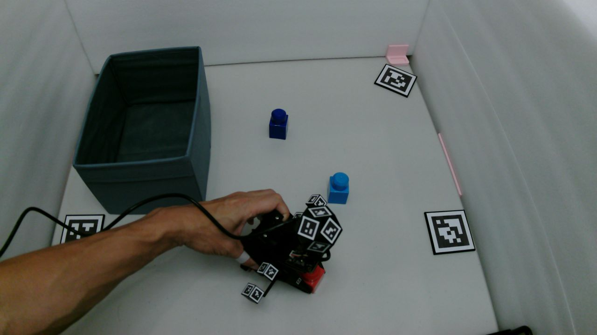
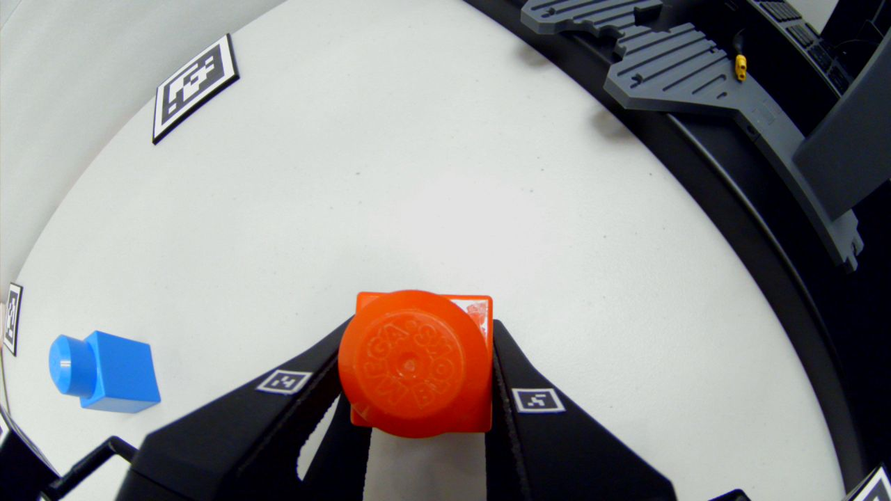
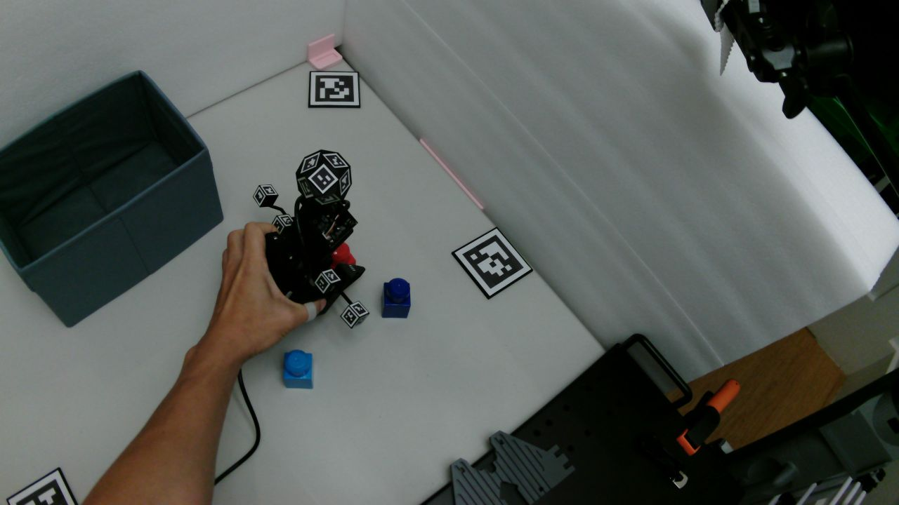

# Collecting for the YAM-UMI pilot (hand-off to a second unit)

This is the sequence for recording glove sessions on **your** machine that
we can build into training data on ours, for the same task as our sessions.
Everything below runs from the repository root. Where a command names a
unit, use yours (`yuan`); the files for it are already in `calib/`.

Watch first (shared Drive folder "yam-umi media"):
<https://drive.google.com/drive/folders/1A3SBs7IUfbYdoRoXje2VuOOWQ2xeptib>
— `glove-collection-demo.mov` (a session as recorded: the rig, the pace,
the episode rhythm), `demo-pick-place.mp4` (the task), and
`glove parts : measurements.zip` (the parts tally and assembly photos).
Your unit's marker calipers are already in `calib/marker_map_glove_yuan.json`.

## The task

Pick the red block and place it in the bin. One episode = one pick-and-place:
start with the glove open at the start zone, reach, grasp, carry, release
over the bin, withdraw; ENTER at the start, ENTER after the release. 6–10 s
at a natural pace; don't slow down for the camera. Vary the block's start
position across the workspace every episode (we deliberately cover the
whole table, including the far and lateral edges); keep the bin where it is.
Discard (`d`) an episode where you dropped the block or bumped the bin.

Reference frames from our rig (match these by eye):

| forward camera (label + policy view) | wrist fisheye | head cam (optional) |
|---|---|---|
|  |  |  |

## Workspace layout: the tiles define the shared frame

On our own rig the tiles were a backup. For a session recorded on **another
rig they are load-bearing**: your pose labels come out in your camera's
frame, and the only way to express them in our robot's frame — where the
training actions live — is through something both rigs can see at known
places. That is the tiles. So your camera does not need to be where ours
is (any height or angle the mount allows), but the **workspace tiles**
(36h11, ids 2–5, 75 mm tiles) must sit at the same places relative to the
task as ours. Place them flat on the table, outside the central working
area but well inside the forward camera's full frame, at the tile-to-tile
distances below (tape-measure between tile centres; ±5 mm is fine — well
inside the label error budget). Put the bin and the start zone where they
are relative to the tiles in the reference frame above. Never use tile 0.

```
TILE LAYOUT — centre-to-centre distances, mm (calib/workspace_tiles_pilot.json)
world frame: origin = tile 5, +x toward tile 4, z up; all tiles flat on the table

           tile 2 (575, 283)            tile 4 (750, 0)
                 .                           .

   tile 5 (0, 0)                 tile 3 (190, -325)
         .                             .

   5-4: 750    5-2: 641    5-3: 377    4-2: 333    4-3: 647    2-3: 720
```
Tile 1 is not used (it was never in our camera's view); tiles 2–5 are all a
solve needs. Our forward camera sits about 0.57 m above the table with its optical axis
34° from vertical (measured from the tiles: `tiles_pose.py solve` prints the
camera's position in the tile frame), framing all four tiles with the bin
and start zone between them — yours should frame the same four tiles; the
exact height and angle are free.

## Steps

0. **Install** — README §0. Then `python scripts/cameras_setup.py`: it previews
   every camera and writes `calib/cameras.json` with *your* USB ports. The two
   4K cameras are indistinguishable by name, so this step is the only thing
   that keeps "forward" and "head" from being swapped. Rehearse with
   `python scripts/record_session.py --glove --cameras_only` (previews only).
1. **Focus and intrinsics** — README §2–3, for all three cameras:
   ```
   python scripts/focus_tune.py /dev/v4l/by-path/<forward>
   python scripts/focus_tune.py /dev/v4l/by-path/<head> --ref /dev/v4l/by-path/<forward>
   python scripts/calibrate_uvc.py /dev/v4l/by-path/<forward> --square-mm <board> --marker-mm <board>
   python scripts/calibrate_uvc.py /dev/v4l/by-path/<head> --name B0587b --square-mm <board> --marker-mm <board>
   python scripts/calibrate_uvc.py /dev/v4l/by-path/<wrist> --name fisheye_glove_yuan --model rational --square-mm <board> --marker-mm <board>
   ```
   Caliper your ChArUco board's square and one marker (black edge). You have
   our earlier print of the same board; we never calipered that one (nominal
   25.0 / 18.0 mm), and a different print of ours measured 25.07 / 18.06 —
   a 0.3 % size error is 2 mm of range at 0.7 m, so measure yours. Aim for
   edge px ≈ 2–3 on a tile at 1 m on both 4K cameras; our head camera at 7 px decoded a second
   ball face in 5 % of frames, at 4 px in 92 %.
2. **Ball and gripper geometry, once** — README §6: one calibration take
   (`--num_episodes 1`, slowly rotate the ball through every orientation at
   working distance, show the gripper-back markers part of the time), detect,
   then the three solve commands with your intrinsics and
   `calib/marker_map_glove_yuan.json`. Expect ~0.5 px RMS over all 11 faces.
3. **Width holds, once** — README §4: spacers, five apertures, rotate the glove
   during each hold so the forward camera sees both jaws; both tips must
   decode in the wrist camera at every hold.
4. **Record** — 30 episodes per session, several sessions:
   ```
   python scripts/record_session.py --glove --dataset glove_yuan_01 --num_episodes 30 --task "pick red block into bin"
   ```
   Lights on and steady; if the pre-flight says WASHED OUT, replug that camera.
5. **Detect** — all three streams: `python scripts/detect_parallel.py data/raw/glove_yuan_01_<cam>.mkv --keep-27`.
6. **Check** — `python scripts/session_check.py glove_yuan_01 --unit yuan`
   prints per-episode pose and width coverage, the hold sanity and which tiles
   the forward camera sees, and ends with "OK — ship it" or a list of problems.
   Fix and re-record rather than ship a session that fails.
7. **Camera → tiles** — `python scripts/tiles_pose.py solve glove_yuan_01_b0587 --intr calib/B0587_intrinsics.json --tags calib/tags36h11_yuan.json --layout calib/workspace_tiles_pilot.json`
   (expect ≤ 1 px RMS and a few mm spread; this is what places your labels in
   our frame). Once per camera position — rerun if the mount moves.
8. **Ship** — `python scripts/pack_session.py glove_yuan_01 --unit yuan --dest <where we tell you>`
   lists the files (sessions are 7–14 GB each) and prints the rsync line.

## What happens on our side

Hand-eye and tool-frame transforms (they need the robot), dataset builds,
training and rollouts. We never need your raw video re-encoded or trimmed:
the episode boundaries live in `_glove_episodes.json`, and the holds in
`_glove_log.json`.
